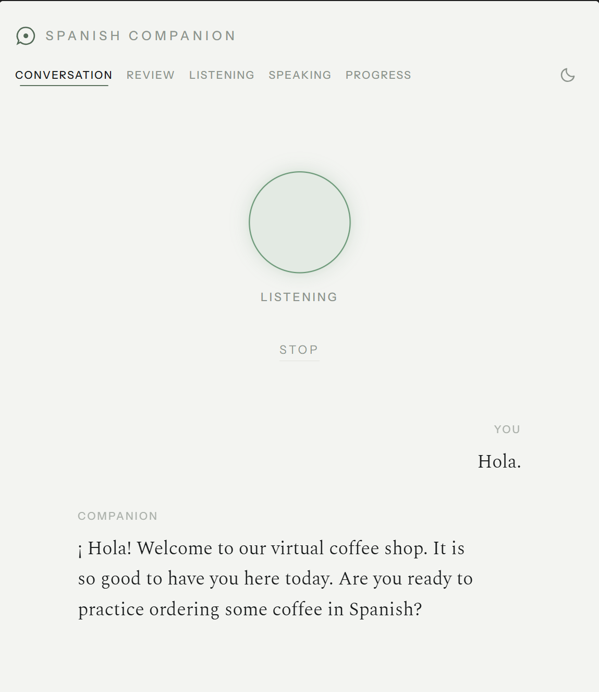
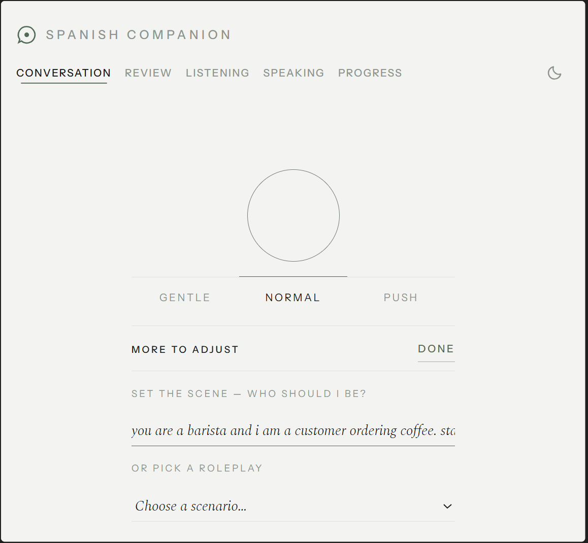
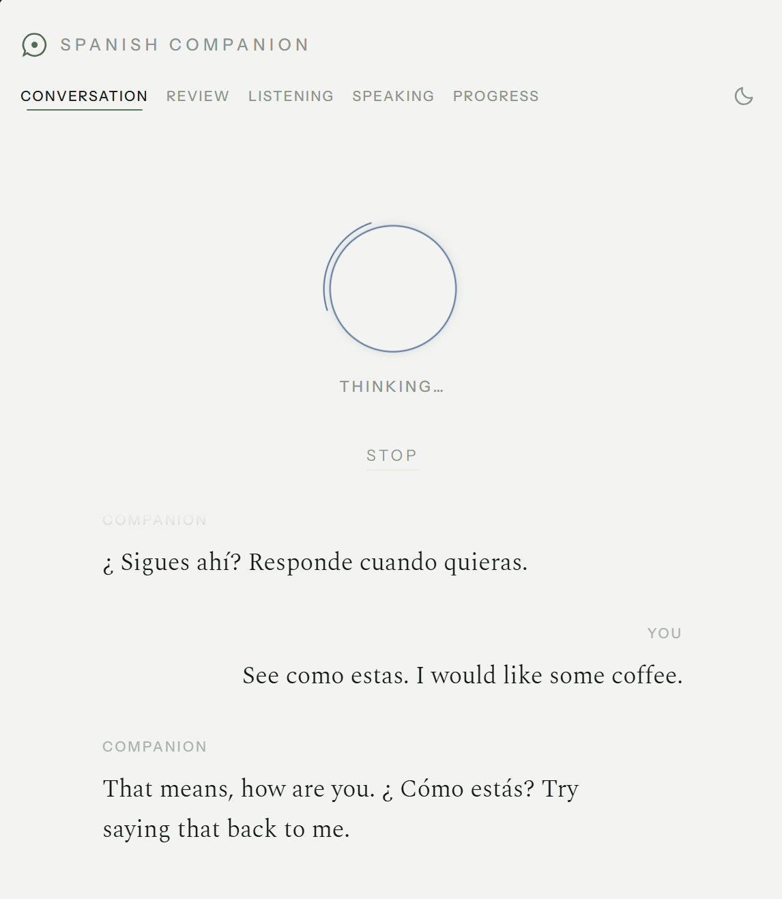
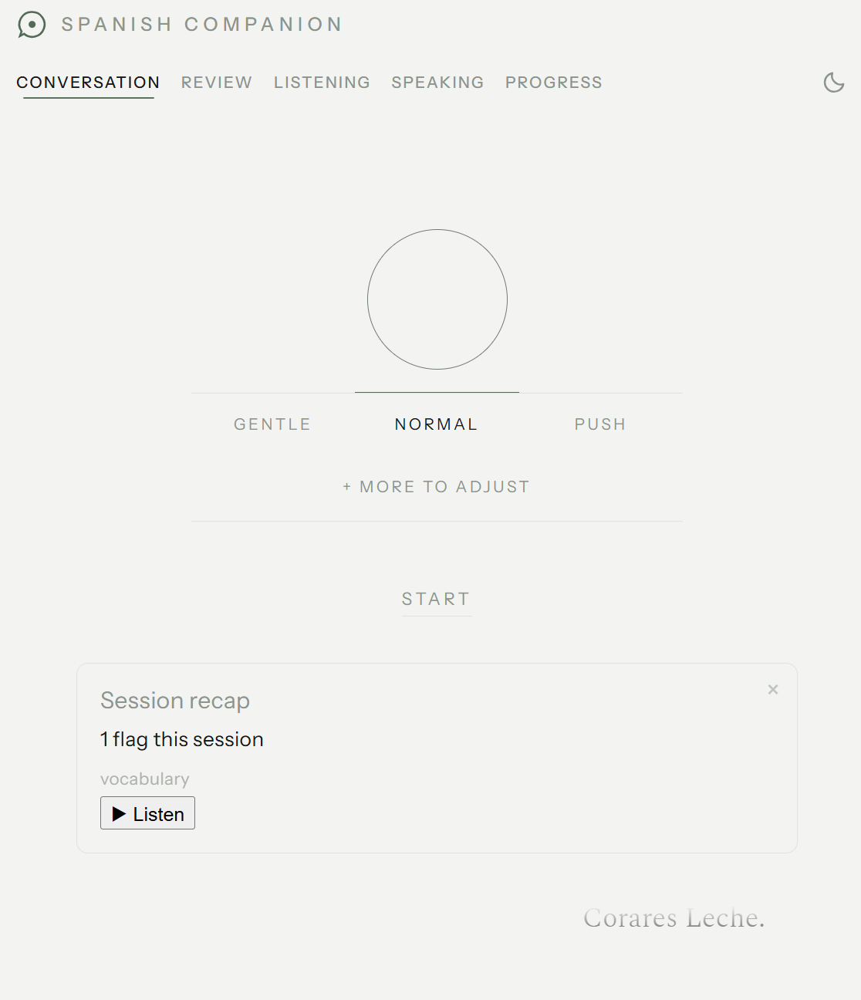
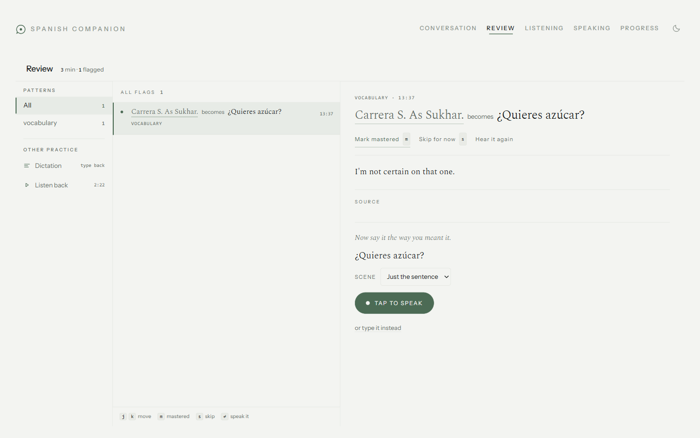
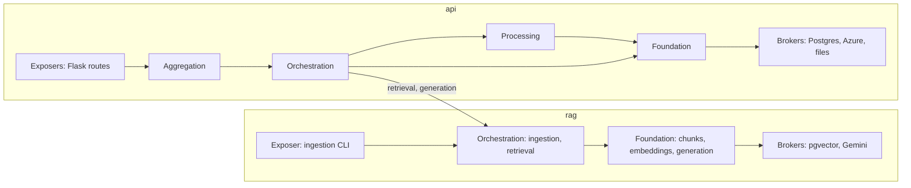

# Spanish Companion

A voice-first Spanish conversation partner. You talk to it like a friend and it answers in real time. Your mistakes are flagged quietly while you talk, never interrupting. When the conversation ends, you review the flagged errors, pick one, and get an explanation grounded in the RAE grammar, then practice saying it correctly.

> **Status:** under active development. Everything below runs locally; there is no public demo.



## What it does

- **Conversation Mode.** Real-time voice loop with a configurable scene ("you are a barista...") and difficulty (Gentle / Normal / Push). Nothing expensive runs here: no retrieval, no spoken corrections.
- **Review Mode.** Untimed. Each flagged error gets a RAG-grounded explanation sourced from RAE grammar pages, then a single practice attempt by voice or typing.
- **Session recap and progress.** A recap card after each session, plus mistake patterns, topics covered and speaking streaks over time.
- **Pronunciation and replay.** Pronunciation assessment, shadowing drills, and audio playback of past sessions.

| Pick a scene and difficulty | Companion is thinking | Session recap |
|---|---|---|
|  |  |  |



## Design principle

Live conversation must stay fast and natural, so all grounding and correction work happens later, in a separate untimed Review Mode. That one rule decided most scope questions.

## Tech stack

| Concern | Technology |
|---|---|
| Voice orchestration | Pipecat (Python) |
| Speech-to-text, text-to-speech | Azure Speech |
| LLM (conversation and RAG answers) | Gemini Flash-Lite |
| Database | Postgres + pgvector |
| Embeddings | sentence-transformers, `paraphrase-multilingual-MiniLM-L12-v2` (384-dim) |
| Corpus | RAE grammar pages |
| Backend | Flask |
| Frontend | React + TypeScript, Vite |

## Architecture

The backend is a modular monolith: one deployable, split into two packages. `api` (sessions, voice, review, progress) depends on `rag` (ingestion, retrieval, generation) and never the reverse. Layers inside a package only call downward.



- **Exposers** map HTTP to the business layer and hold no logic.
- **Aggregation** combines more than one orchestration for a single route (the session recap).
- **Orchestration** coordinates a feature across services.
- **Processing** holds higher-order logic over one foundation service, such as upserts and computed counts.
- **Foundation** validates input and wraps one broker, mapping its exceptions to domain exceptions.
- **Brokers** are thin wrappers over external systems, defined as `typing.Protocol`.

The frontend mirrors this with React hooks per feature (`frontend/src/hooks/`).

## Testing and evaluation

- **1,024 backend tests** in three tiers: unit (every broker mocked), integration (real Postgres, external APIs mocked), and acceptance (the full Flask app in-process). Frontend tests use vitest and Testing Library.
- **RAG evaluation** over 24 grammar questions (run 2026-10-02, top-k 3):

| Metric | Result |
|---|---|
| Retrieval hit rate | 1.00 |
| MRR | 1.00 |
| Answer pass rate | 0.61 |

Retrieval finds the right passage on every question. Generating a grounded answer from it is the open work: pass rate varies by topic and is 0.00 on articles. The eval runs from `evals/run_eval.py`.

## Known limitations

- **Live voice does not run in Docker.** Conversation Mode captures audio from the host microphone through pipecat's local audio transport, and a container has no audio device. Docker images serve every other view. Voice needs the app run directly on the host; a browser-based (WebRTC) transport would be needed to move it into a container.

## Repository layout

```
api/       sessions, voice conversation, review, progress
rag/       ingestion, retrieval, generation
common/    shared brokers and errors
frontend/  React + TypeScript UI
evals/     RAG evaluation questions and reports
alembic/   database migrations
tests/     unit, integration, acceptance
```
