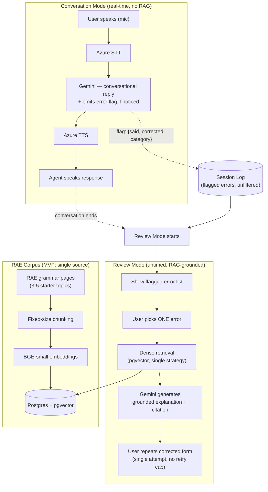

# Spanish Learning Companion — MVP Scope Document

**Purpose of this document**: a working spec for Claude Code to build against.
It defines what's in the MVP, what's explicitly deferred, and the order to
build in. When in doubt about whether something belongs in this pass, check
the "Explicitly Out of Scope" section before adding it.

---

## 1. Project Summary

A voice-first Spanish conversation partner. The user talks to it like a
friend; the agent responds conversationally in real time. Errors the user
makes are quietly flagged during conversation (no interruption). After the
conversation ends, the user reviews flagged errors, picks one to focus on,
and gets a grounded, sourced explanation (from RAE / Wiktionary / Instituto
Cervantes) with a chance to practice the correction.

**Design principle driving every scope decision below**: live conversation
must stay fast and natural — nothing expensive (RAG, verification) runs
during Conversation Mode. All grounding and correction work happens in the
separate, untimed Review Mode.

---

## 2. Two Modes

### Conversation Mode
- Real-time voice loop: mic → STT → LLM → TTS
- LLM persona: warm, conversational, patient — a friend, not a teacher
- While generating each reply, the LLM also emits a lightweight structured
  flag for any error it notices (no extra model call — this is a byproduct
  of the same generation call that produces the spoken reply)
- No RAG calls happen in this mode. No corrections are spoken aloud here.

### Review Mode
- Triggered when the conversation ends
- Shows the user the list of flagged errors from that session
- User picks ONE to focus on (MVP: single selection, not multi-select)
- System runs RAG against the grammar corpus to ground an explanation for
  that specific error
- Presents the grounded explanation to the user
- User attempts the corrected form once
- Session ends after this single correction pass (no retry loop in MVP)

---

## 3. Architecture Diagram (MVP scope)

**What this diagram intentionally omits** (per Section 4): BM25/hybrid
retrieval paths, pre-retrieval query rewriting, post-retrieval verification,
severity tiering before logging, error clustering, retry loops, and
cross-session memory. Those get added as new branches in a later revision
of this diagram, once the MVP loop above is working end-to-end.

---

## 4. Foundational Features (Build This)

1. **Voice pipeline** (Pipecat): mic input → Azure STT → Gemini (conversational
   persona) → Azure TTS → speaker output, with basic turn detection.
2. **Live error-flagging**: LLM's reply-generation call also returns a
   structured flag `{said, corrected, category}` when it notices an error.
   No severity tiering in MVP — log everything flagged, unfiltered.
3. **Minimal RAG stack**:
   - Ingestion: fetch a small starter corpus from RAE (a handful of grammar
     topics — preterite vs. imperfect, ser vs. estar, subjunctive basics)
   - Chunking: simple fixed-size chunking (no section-aware chunking yet)
   - Embedding: one model (BGE-small), no comparison against alternatives
   - Retrieval: ONE strategy only — dense (vector similarity via pgvector).
     No BM25, no hybrid, no strategy comparison in MVP.
   - No pre-retrieval query rewriting in MVP — pass the flagged error's
     `corrected` field directly as the retrieval query.
   - No post-retrieval relevance filtering/verification in MVP — take the
     top result as-is.
4. **Review Mode v0**:
   - Flat list display of session's flagged errors (no clustering/theming)
   - User picks one
   - RAG retrieves + LLM generates a grounded explanation, citing the source
   - User repeats the corrected form once; session ends (no retry cap logic,
     no adaptive re-teaching — that's v2)
5. **Minimal UI**:
   - Mic control (start/stop)
   - Live transcript (both sides of the conversation)
   - Simple listening/speaking state indicator
   - Review Mode screen: flagged error list → selection → explanation
     display (plain text citation, not spoken)

---

## 5. Explicitly Out of Scope for MVP

Do not build these yet. They were discussed and designed conceptually, but
are deliberately deferred so the MVP stays buildable:

- BM25 / hybrid retrieval, or any retrieval-strategy comparison (rag-bench
  style evaluation belongs in a later pass, once real data exists)
- Severity tiering of errors (trivial vs. meaningful)
- Clustering flagged errors into themes
- Multi-attempt retry loop with a cap, or adaptive re-teaching ("try a
  different angle")
- Cross-session memory (nothing persists between sessions in MVP)
- Spoken citations — citations are visual/text only for now
- Guided conversation scenarios/topics — MVP is freeform chat only
- Fallback handling for ungroundable questions beyond a simple "I'm not
  certain on that one" default response
- Pre-retrieval query rewriting
- Post-retrieval relevance verification/filtering
- Observability/OpenTelemetry instrumentation (add once the pipeline
  actually works end-to-end)
- Any deployment/infrastructure work (Terraform, hosting) — local dev only
  for MVP

If something from this list feels necessary while building, stop and flag
it rather than silently adding it — the scope boundary is deliberate.

---

## 6. Tech Stack

- **Voice orchestration**: Pipecat (Python)
- **STT + TTS**: Azure Speech (free tier)
- **LLM**: Gemini Flash-Lite (free tier) — both conversation and RAG
  generation use this model
- **Database**: Postgres + pgvector (hosted — Neon or Supabase)
- **Embeddings**: sentence-transformers, BGE-small
- **Corpus sources**: RAE only for MVP (Wiktionary/Cervantes are later
  additions, not MVP)

---

## 7. Build Order

1. Voice loop working end-to-end — you can talk and hear a natural-sounding
   response back. No error-flagging, no RAG yet. Verify this feels
   conversational before adding anything else.
2. Add live error-flagging to the existing loop. Confirm flags are being
   captured correctly (log them to console/file for inspection) before
   building any UI around them.
3. Stand up ingestion for a small RAE starter corpus (3-5 grammar topics)
   and dense retrieval against it. Test retrieval quality manually — does
   asking about "preterite vs imperfect" actually return the right chunk?
4. Build Review Mode v0: flagged list → selection → RAG-grounded
   explanation → single practice attempt.
5. Only after 1-4 work end-to-end: revisit the "Out of Scope" list and
   decide what to add next, based on what actually felt missing while
   using it.

---

## 8. Open Questions Deliberately Not Resolved Yet

These came up during planning but don't block MVP — revisit after the
foundation works:

- How does a session start (cold open vs. referencing prior session)?
- What does the app do with mastered/resolved errors over time?
- Should conversation ever proactively steer toward a known weak spot?
